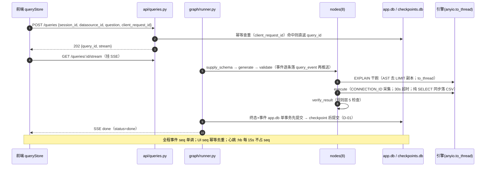
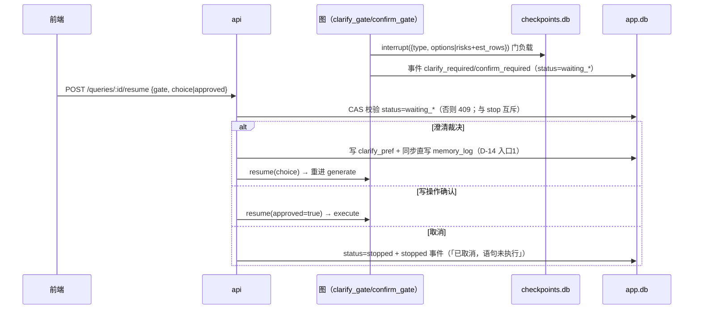
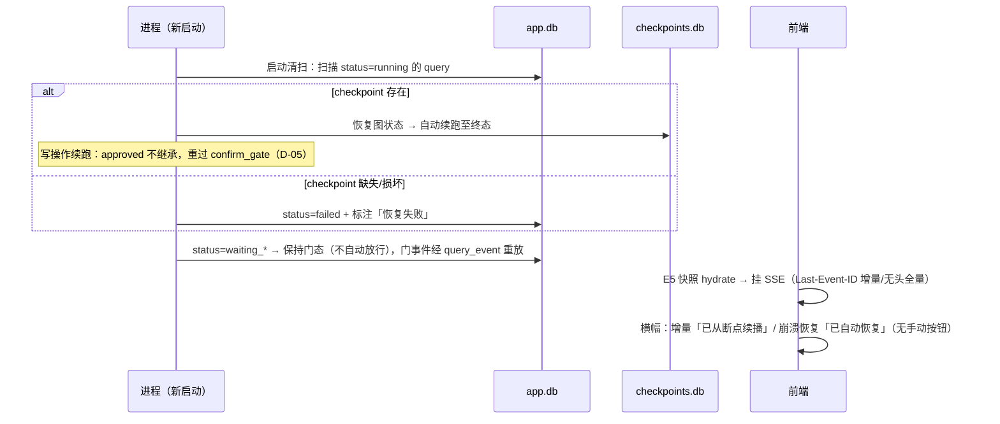

# AItosql 个人版 Text2SQL · 技术设计（design）

> 阶段产物：03-design / design ｜ 运行：sdlc-20261015015550-sdpj1
> 上游：`proposal.md` 与 `specs/spec.md`（需求侧唯一输入）、`prototype/*.html`（交互验收基准）；权威依据：SSOT v3.2（整体需求解决方案）。
> 证据纪律：本文引用的接口/字段/默认值均来自 SSOT 对应章节、spec.md 数据字典、sqlglot 30.18 实测探针或 `prototype/*.html`（验收基准），逐条标注出处；**工作区无既有产品代码（已核验 `app/ web/ scripts/ tests/ configs/` 均不存在）**，凡无法由上述证据佐证的结论一律标 **TODO**，置信度不超「中」。
> 追溯约定：全文设计条目统一编号 **D-xx**（段 3 决策 D-01~D-22、段 4 模块 D-30~D-43），`tasks.md` 每项任务反向追溯到这些条目；段内引用 SSOT 用 `§n` 记。

---

## 段 1 · Context（背景 + 当前状态 + 约束）

### 1.1 背景

个人版 Text2SQL（智能优先、本地部署、单用户）：自然语言 + 库表元数据 → 方言正确（MySQL/Doris/ClickHouse）、可执行、带假设说明的 SQL；执行后必经 `verify_result`，「校验过了才停止」；结论可复核（复核包）；默认 local_only 零出境（SSOT §1，P1-P7）。本阶段把 SSOT 的「可编码规格」落成工程设计与契约集合，供 Phase 0-4 编码直接消费。

### 1.2 当前状态（工作区证据）

1. **无产品代码**：`glob {app,web,scripts,tests,configs}/**` 零命中——全新构建（greenfield），无遗留代码约束，亦无「复用已有实现」对象。
2. **需求侧已闭环**：SSOT v3.2 含真实 DDL（migrations 0001~0004）、QueryState TypedDict、SSE 十六事件、API 30+ 端点、配置默认值 40+ 键、开发计划 4 Phase 23 任务（SSOT §3/§4/§5/§10/§14）。
3. **关键风险点已有实测证据**：sqlglot 30.18 实测探针（`SELECT 1;;SELECT 2` → `[Select,None,Select]`；INTO OUTFILE/DUMPFILE 全语序 PARSE_FAIL；`INTO @v` 为唯一可解析 exp.Into 形态；CALL→exp.Command；DO/HANDLER/LOAD DATA→PARSE_FAIL；EXPLAIN ANALYZE→`Describe.style=ANALYZE`；CH 侧 EXPLAIN/SYSTEM/SHOW→Command、GRANT→Grant、KILL QUERY→PARSE_FAIL）。
4. **视觉与交互基准冻结**：`prototype/*.html` 四页存在且含复核包/E3010/澄清门等验收锚点，为前端验收基准。
5. **配套设计一致**：数据源模块配套设计的实体/合并策略/AI 补全与 SSOT 基本一致，差异两项（`ai_suggestion.status` 用词、`target` 列）以 SSOT §3.1 为准（propose §8 #2）。

### 1.3 约束（每条带来源）

| # | 约束 | 来源 |
|---|------|------|
| C1 | 本地部署单用户：监听 127.0.0.1:8321 + Bearer token，CORS/Origin 同限定 | SSOT §4 `server.*`、§10.1 |
| C2 | 双库铁律：app.db 终态权威（入备份）/ checkpoints.db 进度权威（不入备份）；写入顺序 app.db 单事务先提交 | SSOT §5.4 |
| C3 | 技术栈锁版本：Python 3.13 / langgraph ≥0.2 / sqlglot 30.18 实测 / React 19 / Vite 6 / fastembed+bge-small-zh-v1.5 | SSOT §2.1 |
| C4 | 分层守则 D1-D6：api→graph→领域（七模块禁互导）→store；三方 import 收口；SQL 拼装限 store/+retrieval/；唯一耦合面 /api+SSE | SSOT §2.3 |
| C5 | 所验即所执：validate 后禁止任何 SQL 重写；确认门展示串 = execute 执行串 | SSOT §5.2 |
| C6 | 幂等键：`client_request_id = thread_id = query_id`（`q_`+ULID）；SSE seq 单调幂等 | SSOT §5.4、§10.2、§12.7 |
| C7 | 超时矩阵：query.timeout_s=30 / explain_timeout_s=5 / ch_client_timeout_s=35 | SSOT §4、§5.4-7 |
| C8 | 密钥：keyring 五款 fail-closed 拒启；Fernet；备份剥离密文；数据文件 0600 | SSOT §12.4、§12.3 |
| C9 | 视觉验收：tokens.css 唯一 token 来源 + stylelint 禁裸 hex；四页对照原型走查 | SSOT §11（V3）、§14 T0.2 |
| C10 | 质量门禁：golden 滚动门槛 P1≥15/P2≥30/P3≥40/T4.1=50（三方言）；ruff+mypy+import-linter 进 CI | SSOT §14 尾注、T0.4 |
| C11 | 出境管控：默认 local_only 零出境；云路由触发出境清单 E1-E8（E6 红标）；verify_llm local_only 置灰 | SSOT §12.5、§9.2 |
| C12 | 离线库（mode=offline）只生成不执行；R13 降级黄警照常交付 | SSOT §5.2、FR-D13 |

---

## 段 2 · Goals / Non-Goals

### 2.1 Goals（技术层）

| # | 技术目标 | 需求锚点 |
|---|---------|---------|
| G1 | 查询主链路图（supply→generate→validate→双门→execute→verify→correct）以 LangGraph 可中断/可恢复方式实现，终态+事件全部可重放 | propose G3/G4；SSOT §5 |
| G2 | 安全纵深：R01-R14 告警 + R15 五断言硬阻断 + 写确认门 + CH 强制 readonly=1，全部经 sqlglot AST 实现且有探针复现用例 | propose G2；SSOT §9.1 |
| G3 | 双库 + 事件溯源支撑三类恢复：崩溃自动续跑、SSE 断连续播、备份恢复降级 | propose G4；SSOT §5.4/§12.3 |
| G4 | 语义层闭环：摄取→标准/关系/指标→注入（8 段信封）→AI 建议队列→采纳生效；提示词视图/组装预览与真实注入逐字一致 | propose G1/G5；SSOT §8、§12.2 |
| G5 | 记忆双层与会话压缩：flush 三入口、水位线合并、压缩先抢救（flush 失败压缩推迟），40 轮压缩事实零丢失 | propose G5；SSOT §12.6；spec §5.3 强制约束 |
| G6 | 四页前端（React 19+Vite 6）对照原型走查通过；干净机器单命令启动 | propose G6；SSOT §14 T0.2/T4.4 |

### 2.2 Non-Goals（溯源 propose §3.2）

多用户/行列级权限/MCP 网关/BI 图表/并行下钻编排/血缘分析/指标平台/标准批量导入导出/ER 力导向自动布局/企业审计 SSO 多租户；不新增 `POST /queries/:id/retry`；query_event 不设 retention（见段 10 TODO）。

---

## 段 3 · Decisions（技术决策，D-01~D-22）

> 每个决策：内容 / 理由 / 替代方案（拒绝原因）/ 证据。

### D-01 双库归属与写入顺序
- **内容**：`data/app.db`（SQLite WAL）= 终态权威（query/result_preview/query_event/session…，入备份）；`data/checkpoints.db`（langgraph-checkpoint-sqlite，独立文件）= 进度权威（图进度 + `__interrupt__` 门负载，不入备份）。**写入顺序铁律**：终态事件与 status 在 app.db 单事务先提交，checkpoint 后提交。
- **理由**：备份恢复后 checkpoints.db 缺失时语义明确（running 一律 failed+标注）；事件溯源与图进度解耦，SSE 续播只依赖 app.db。
- **替代**：单库双表——被拒绝：checkpoint 含最大明文聚合体，混入备份违背密钥/明文边界（SSOT §3.3 备份归属注）。
- **证据**：SSOT §5.4 双库归属铁律；§12.3 恢复语义。

### D-02 同步 IO 全部隔离出事件循环
- **内容**：引擎调用（PyMySQL / clickhouse-connect）与 SQLite 写全部走 `anyio.to_thread`；checkpointer 用 `AsyncSqliteSaver`；FastAPI 端点与图节点全 async。
- **理由**：同步驱动在 async 节点内会冻结事件循环（SSOT 风险 R7），SSE 心跳与多查询并发直接受害。
- **替代**：换 async 引擎驱动（aiomysql 等）——被拒绝：Doris 仅 PyMySQL 兼容、clickhouse-connect 无官方 async；引入第二套连接栈增加方言矩阵维护面。
- **证据**：SSOT §5.4-6、§16 R7。

### D-03 validate 执行序铁律 + 所验即所执
- **内容**：validate 节点内固定顺序：Unicode 清洗 → R04 auto_limit **AST 注入** → **R15 优先** → R01-R14 → 标识符归一（`normalize_identifiers`→`qualify`）→ EXPLAIN 干跑（AST 去 LIMIT 副本，**干跑串永不进 execute**）。validate 之后任何模块不得重写 SQL；confirm_gate 展示串与 execute 执行串逐字相同（同一 `state.sql`）。
- **理由**：auto_limit 必须发生在校验前，否则「所验非所执」；R15 优先避免告警噪音淹没硬阻断。
- **替代**：字符串拼接 LIMIT——被拒绝：方言差异（CH `LIMIT n` / Doris 同 MySQL 但子查询位置敏感）+ 注释/分号边界不可靠；AST 注入可复现、可 golden 固化。
- **证据**：SSOT §5.2 节点规格、§5.3；spec §3.5。

### D-04 R15 五断言的 AST 实现形态
- **内容**：B1 多语句 = `sqlglot.parse()` 过滤 None 后语句数 ≠1；B2 解析失败族 fail-closed（含 INTO OUTFILE/DUMPFILE 全语序、LOAD DATA [LOCAL] INFILE、INSTALL PLUGIN、DO、HANDLER）；B3 显式断言 `exp.Into`（唯一可解析形态 `INTO @var`，枚举文件变体防升级漂移）；B4 `exp.Describe` 且 `style=ANALYZE` 一律阻断（含包纯 SELECT）；B5 契约外语句族 CALL/DO（CALL 为不透明 `exp.Command`，由 B5 拦；USE/SET/KILL/GRANT/SYSTEM 可解析族留 R01 红+确认门兜底）。
- **理由**：探针实测证明 PARSE_FAIL 覆盖面 > AST 枚举，fail-closed 是唯一安全默认；`parse_one` 静默取首条（SSOT R8）必须靠 B1 计数兜底。
- **替代**：正则黑名单——被拒绝：注释/字符串/语序变体绕过面大，且无法覆盖方言差异。
- **证据**：sqlglot 30.18 探针实测输出（INTO 四语序全 PARSE_FAIL、`INTO @v`→exp.Into(Parameter(Var))、CALL→Command、DO/HANDLER→PARSE_FAIL、`SELECT 1;;SELECT 2`→`[Select,None,Select]`、EXPLAIN ANALYZE→Describe.style=ANALYZE）；SSOT §9.1。

### D-05 双门 = langgraph interrupt + CAS resume
- **内容**：clarify_gate/confirm_gate 用 `interrupt({type, payload})` 悬停，门负载进 checkpoint；裁决走 `POST /queries/:id/resume`（`{gate, choice?, approved?}`），**CAS：仅 `waiting_*` 态可 resume**（与 stop 互斥）。写操作 crash 续跑时此前 approved **不继承**，必须重过 confirm_gate。interrupt 前不得产生任何引擎/写库副作用。
- **理由**：门语义要求「不自动放行」；CAS 消灭 resume-stop 竞态；写操作重过门是 crash 安全款。
- **替代**：轮询门表自管状态机——被拒绝：langgraph interrupt 原生承载门负载与恢复，自管等于重实现 checkpointer。
- **证据**：SSOT §5.4-2/3/5；spec §3.5。

### D-06 SSE = query_event 事件溯源重放（唯一耦合面）
- **内容**：16 个业务事件全部先落 `query_event`（`PRIMARY KEY(query_id,seq)`，seq 单调）再推送；帧 `id: {query_id}:{seq}`；重连带 `Last-Event-ID` 增量、无头全量自 seq=1；连接级控制帧 `stream_resumed` 与心跳注释帧 `:hb`（每 `sse.heartbeat_s`=15s）不占 seq 不入表。前后端唯一耦合面 = `/api` + 该 SSE 流。
- **理由**：事件落库使断连恢复、崩溃恢复、E5 快照三者共用同一事实源；result 批量行不入事件表（走 result_preview），单事件 ≤`sse.event_payload_kb`=16KB 截断标注。
- **替代**：内存队列 + 断线丢弃——被拒绝：与崩溃续跑/断连续播/复核诉求根本冲突。
- **证据**：SSOT §10.3、§3.3、§5.4；spec §3.2。

### D-07 schema 供给 = 双路召回 RRF + 滞后带 + 一次二次供给
- **内容**：FTS5 top-12（bm25 聚合到表级）+ 向量 top-4（distance≤0.35，FTS 命中 ≥6 表不触发向量）→ RRF k=60 按 table_id 去重 → `rrf_score DESC, table_name ASC` 确定性排序；库表 ≤30 或估算 ≤预算 → full 模式；模式切换滞后带 55-65% 保持上次模式；R13（online）且 `resupply_used=false` 时经 `need_tables` 回 supply 补表一次；检索失败降级 full 截断。
- **理由**：双路互补（FTS 吃精确命名、向量吃语义），RRF 免调分；滞后带防模式抖动导致同会话注入漂移。
- **替代**：单向量召回——被拒绝：中文 FTS 需应用层 bigram，单独任一路在 golden 上均不如融合。
- **证据**：SSOT §5.2 supply_schema、§4 `schema.*`；spec §4.6。

### D-08 向量层：fastembed 本地嵌入 + schema_vec 运行期建表
- **内容**：fastembed + BAAI/bge-small-zh-v1.5（512 维）；`schema_vec` 不写死 migration，运行期按 `schema.embed_dim` 建表；换模型流程 = 改 setting → 重建 vec 表（期间 `schema.vector` 临时 off，降级纯 FTS）→ 完成自动恢复；FTS 表不动。权重首启缺失处置见段 10 TODO-1。
- **理由**：嵌入维度随模型变，DDL 写死会锁死换模路径；降级纯 FTS 保证重建期可用。
- **替代**：pgvector/外部向量库——被拒绝：本地单用户零依赖原则，sqlite-vec 足够（表级向量量级 ≤ 数千）。
- **证据**：SSOT §3.2、§2.1、§4 `schema.embed_*`。

### D-09 提示词 8 段信封 + 5 步裁剪 + 预览同源
- **内容**：信封 = system + dialect_card + memory + session_summary + schema + samples + metrics(命中) + question；输出预留 `min(4096, 25%×total_ctx)`，`total_ctx` 缺省 32768；超 `schema.budget_pct`(60%) 依次裁剪：①减样例 ②减枚举(top8→top4) ③retrieval 重建减表 ④减记忆条目（最旧未命中） ⑤尾部确定性截断。token 估算 `max(len//1.7 中文, tiktoken cl100k 英文)`，留 ±15-20% 余量。**组装函数唯一**：设置页组装预览与表详情提示词视图由同一 `llm/prompts.py` 生成，保证「与真实注入逐字一致」。
- **理由**：预览同源消灭「预览≠注入」漂移；裁剪顺序把口径直接相关的记忆排在样例之后保留。
- **替代**：前端拼装预览——被拒绝：双端实现必然漂移。
- **证据**：SSOT §8.3、§10.4；FR-C4、FR-D8。

### D-10 密钥 Fernet + keyring 五款，fail-closed
- **内容**：密钥获取顺序 keyring → `AITOSQL_FERNET_KEY` 环境变量（仅内存）→ 首启生成；keyring 不可用拒启；密文只进 `provider.api_key_enc`/`datasource.password_enc` BLOB；轮换走 E4001 重新录入不迁移；备份把两处密文写 NULL（双封）。
- **理由**：个人版最大泄露面是备份外发与配置文件误传；fail-closed 优于静默降级为明文。
- **替代**：master password 派生——被拒绝：单用户本地场景增加每次启动交互成本，keyring 已覆盖桌面系统。
- **证据**：SSOT §12.4、§12.3、§18.2；验收 propose §9-14。

### D-11 脱敏规则表统一三出口
- **内容**：连接串→`[HOST]`/`[PORT]`、账号密码→`[USER]`/`[CREDENTIAL]`、IP 白名单仅放行 127.0.0.1/localhost、SQL 字面值→`?`；同一规则表（`sqlcheck/clean.py`）统一适用三出口：回喂 LLM 的错误、前端回显、query_event 落库。
- **理由**：三出口任一漏脱敏即凭证外泄；单点实现避免规则漂移。
- **替代**：各出口自管——被拒绝：漂移风险。
- **证据**：SSOT §12.5；spec §5.2。

### D-12 verify 规则层 + 全局共享 1 次回退额度
- **内容**：规则层 5 检查（0 行 / 关键列全 NULL / 行数<EXPLAIN 估计 1% / 汇总对账偏差>0.1% / 分区裁剪仅记录），全过才 pass；「回退」共用全局唯一额度 `verify_fallback_used`（QueryState 字段），用后仍不过 → `result_unverified=true` 照常 END（琥珀「未验证」标注）；可选 LLM 层 `feature.verify_llm` 默认关，local_only 置灰，输入截断前 5 行 × 每格 50 字符。
- **理由**：回退无限次会放大延迟与幻觉循环；全局 1 次在「校验过了才停止」与体验间取平衡。
- **替代**：每规则各 1 次回退——被拒绝：多规则连退语义混乱且成本不可控。
- **证据**：SSOT §9.2、§5.1；spec §4.2。

### D-13 修正回路 ≤3 轮 + SQL 指纹振荡检测
- **内容**：引擎报错脱敏后回喂 correct（路由 route.fix），`round` 上限 `query.max_fix_rounds`=3；每轮算 sqlglot 归一化指纹进 `fingerprints`，指纹重复（振荡）即终止：照常交付最近版并标 failed；`correction` 事件在判定入回路时即发。
- **理由**：振荡检测防止 A→B→A 死循环烧 token；≤3 轮是 golden 观测的收敛上界。
- **替代**：仅靠轮数上限——被拒绝：模型在同一错误上来回改写时 3 轮纯浪费。
- **证据**：SSOT §5.2 correct、§5.3；spec §4.2。

### D-14 记忆双层 + 水位线合并 + 压缩先抢救（flush 失败压缩推迟）
- **内容**：流水账 `memory_log` 追加只写（kind: caliber/correction/quirk/preference）；总账 `memory`（scope global/datasource，topic 分组，enabled 开关即停注，≤`memory.max_tokens`=4000，超量裁最旧未命中）；`memory_watermark.last_log_id` 增量合并，最小间隔 `memory.consolidate_min_gap_min`=30min，走 route.ai 小模型。**三入口**：澄清裁决/假设修正/存样例同步直写流水账（零损耗）；查询完成异步 flush（失败静默下轮重试）；人工直管总账。会话 >`session.compact_msgs`=40 触发压缩：先把待压缩轮次事实抢救进流水账，**flush 失败则压缩推迟**（spec §5.3 强制约束），保留最近 `session.keep_msgs`=6 轮完整，其余并入 `session.summary` 滚动摘要（旧摘要参与新摘要，不重复提取记忆）。
- **理由**：无损事实（流水账/底稿）与有损摘要（滚动链）分离；压缩前先 flush 抢救事实，避免压缩丢失事实（SSOT §12.6）。
- **替代**：单层记忆 + 全量历史注入——被拒绝：token 预算与 40 轮长会话超限不可行。
- **证据**：SSOT §12.6、§3.4；spec §5.3 N7 强制约束。

### D-15 样例库 semantic_rev 五因子指纹 + 三条件命中
- **内容**：缓存命中 = `question_norm`（小写/去空白/去标点）精确 ∧ `status=on` ∧ `semantic_rev` 相等；`semantic_rev = sha256(schema_rev, clarify_pref_rev, dialect_card_hash, sem_bind_rev, prompt_sys_hash)`，各 rev 懒惰失效（变更才重算）；命中直返 SQL 并标注「复用已验证结果」；schema 变更（重摄取 diff）→ 引用字段消失/改名的样例置 stale（`stale_reason` 记字段名）→ EXPLAIN 干跑复验回 on。
- **理由**：五因子覆盖所有会改变「正确 SQL」的输入；归一化消除表面差异带来的缓存 miss。
- **替代**：embedding 相似命中——被拒绝：相似不等价，SQL 复用必须确定性。
- **证据**：SSOT §12.1、§3.1 sample DDL；spec §2.10。

### D-16 导出 CSV = 瞬态目录治理
- **内容**：execute 在**纯 SELECT** 成功时同步全量落盘 `data/exports/{query_id}.csv`（UTF-8 BOM + RFC4180，首行表头）；GET 以 FileResponse 流式返回并回显 `data_max_time`；TTL `export.ttl_h`=24h 定时清理 + `export.max_total_mb`=2048 超量 LRU + 启动清扫孤儿文件；exports/ 不入备份、gitignore，密级等同 result_preview；前端导出成功 toast 带「文件保留 24 小时」（TODO-N9 默认假设落位）。
- **理由**：全量结果驻留内存不可行（大结果集）；瞬态语义防止无限堆积。
- **替代**：按需重新执行生成 CSV——被拒绝：数据时效漂移（复核要求与执行当时一致）。
- **证据**：SSOT §10.5、§12.7；propose §8 #8。

### D-17 备份 = VACUUM INTO 滚动 + 恢复语义 ≠ 重启
- **内容**：每 4h `VACUUM INTO '{backup.dir}/app-{yyyyMMdd-HHmm}.db'`，keep=10；入备份仅 app.db（含 query_event，密级标注「SQL 字面量与事件溯源明文」）；剥离密文（写 NULL）；`backup.encrypt=true` 时加密备份文件（不覆盖 exports/）；**恢复后 running 态一律 failed+标注，不适用崩溃自动续跑**，UI 恢复提示明示。
- **理由**：VACUUM INTO 是 SQLite 在线一致性备份原语；checkpoints 绑本地进程，恢复后图状态不存在，failed+标注是唯一诚实语义。
- **替代**：文件拷贝——被拒绝：WAL 下拷贝可能撕裂。
- **证据**：SSOT §12.3、§3.3 注；spec §2.14。

### D-18 ER 图谱摆位存储裁决：新增 migration 0005 `graph_layout`
- **内容**：新增 `migrations/0005_graph_layout.sql`：
  ```sql
  CREATE TABLE graph_layout(
    datasource_id INTEGER PRIMARY KEY REFERENCES datasource(id),
    node_positions_json TEXT NOT NULL DEFAULT '{}',  -- {table_name: {x, y}}
    updated_at TEXT DEFAULT (datetime('now)')
  );
  ```
  归入 app.db（随备份）；手工摆位后保存，读取缺失时前端按表名字典序确定性平铺。
- **理由**：数据源配套设计明确「手工摆位 + 记忆位置（存 graph_layout 表）」，SSOT migrations 0001~0004 无此表属遗漏（propose N1）；独立小表不污染 table_meta。
- **替代**：存 setting 键值——被拒绝：setting 语义是全局配置，按 datasource 的实体数据混进去破坏备份/清理语义。
- **证据**：propose §6.4 N1、§8 #1。**置信度：高**（字段形状为新建设计，无旧代码冲突）。

### D-19 `metric_standard.filter` 列名保留 + 全链路引号/参数化
- **内容**：保留 SSOT DDL 列名 `filter` 不改；所有触及该列的 SQL 经 sqlglot 构造或显式双引号/反引号（按方言），ORM 层（store/models.py）字段访问统一走参数化；代码评审 checklist 增列「metric_standard.filter 必须引号」。
- **理由**：SSOT 为唯一权威，技术设计不擅改 DDL；`filter` 在 MySQL/Doris/CH 非保留字（仅在 `FILTER (WHERE ...)` 聚合语法上下文敏感），引号化即可消除歧义。
- **替代**：改名 `filter_desc`——被拒绝：会造成 SSOT DDL 与代码双源漂移，违反 SSOT 优先原则（propose §8 #2 同款先例）。
- **证据**：SSOT §3.1 DDL；propose §6.4 N3。**置信度：高**。

### D-20 前端状态分层：TanStack Query = REST，zustand = SSE 装配态 + UI 态
- **内容**：REST 数据（sessions/queries/samples/datasources/settings…）全部归 TanStack Query（缓存/失效/重试）；zustand 仅存 SSE 装配态（queryStore S1-S6：MessageModel 同构、appliedSeq、横幅显隐）与纯 UI 态（抽屉/面板开关）；终态 invalidate 三键（sessions/queries/samples）；门裁决 optimistic 回显。
- **理由**：双库各管一类事实，避免 SSE 增量与 REST 快照双写冲突；V4 守则进 CONVENTIONS.md。
- **替代**：单一 zustand 管全部——被拒绝：REST 缓存/失效语义需重造。
- **证据**：SSOT §11.2 守则 V1-V4。

### D-21 前端装配五步 + E5 快照不依赖 checkpoint
- **内容**：进会话 ①`GET /sessions/:id/queries` 快照 hydrate（query+result_preview+query_event 聚合，含 `last_seq` 与 `clarify_choice`，DAO 聚合防 N+1）②running/waiting_* 挂 SSE ③双模重连归一（Last-Event-ID 增量/无头全量）④seq 幂等去重（stream_resumed 不入 appliedSeq；乱序 fail-loud 触发 REST resync）⑤横幅策略（增量亮「已从断点续播」；崩溃恢复亮「已自动恢复」，无手动续跑按钮）。
- **理由**：E5 快照数据源不含 checkpoint，与 D-01 双库归属对偶——checkpoint 丢失（备份恢复）时历史仍可完整渲染。
- **替代**：前端只挂 SSE 等推送——被拒绝：刷新/断连后历史空洞。
- **证据**：SSOT §11.2、§10.1 E5。

### D-22 业务 ID 与幂等键统一 ULID
- **内容**：`s_`/`q_` 前缀 + ULID（Crockford Base32，26 字符，毫秒前缀可排序）；`client_request_id = thread_id = query_id` 三位一体；POST /queries 同 client_request_id 重发返回同一 query_id 不重复执行；门裁决与 stop 均 CAS。
- **理由**：ULID 可排序利于会话消息流与事件接缝；三键合一消灭映射表。
- **替代**：UUIDv4 + 独立幂等表——被拒绝：无序且多一张表。
- **证据**：SSOT §12.7、§10.2、§5.4-7。

---

## 段 4 · 架构与模块设计（D-30~D-43）

### 4.0 总体形态

单进程 FastAPI（uvicorn，127.0.0.1:8321）内嵌：REST `/api` + SSE + 静态 `web/dist`；后台任务（摄取/flush/合并/备份/导出清扫）由 asyncio 任务 + anyio.to_thread 承载；两个 SQLite 文件（D-01）；前端 React 19 SPA 四页。分层守则 D1-D6（C4）由 import-linter 契约在 CI 强制（T0.4）。

```
web/ (React SPA)                      ←唯一耦合面→ /api + SSE
app/
 ├─ api/        L1 路由（CRUD 可直达 store；查询管线必经 graph）   [D-30]
 ├─ graph/      L2 编排（state/nodes/edges/runner，langgraph 收口） [D-31]
 ├─ ingest/ retrieval/ llm/ sqlcheck/ exec/ verify/   L3 七领域模块（禁互导） [D-32..D-37]
 └─ store/      L4 持久化（db/models/samples/suggestions/backup/memory）      [D-38]
configs/dialects/*.yaml  能力卡 [D-41]   scripts/dev.py 单命令 [D-42]   tests/golden [D-43]
```

### D-30 `app/api/`（L1 路由层）
- **职责**：HTTP 契约实现（REST 全表）；Bearer 校验依赖注入；E5 快照聚合；SSE 端点（sse.py：事件桥接 + Last-Event-ID 续播 + 心跳）；resume/stop CAS 入口。
- **输入**：HTTP 请求（Pydantic 校验）；**输出**：JSON envelope `{code, message, data}` / SSE 帧 / FileResponse。
- **边界**：不含业务规则；查询类写操作只调 runner，不直接碰 store SQL（分层 D1 补丁：纯 CRUD/只读可直达 store）。

### D-31 `app/graph/`（L2 编排层）
- **职责**：`state.py`（QueryState/RiskItem/CorrectionRound TypedDict）；`nodes.py`（8 节点：supply_schema/generate/clarify_gate/validate/confirm_gate/execute/verify_result/correct，规格 = SSOT §5.2 表逐行实现）；`edges.py`（§5.3 条件边）；`runner.py`（编译图 + AsyncSqliteSaver + 事件落库 query_event + SSE 桥接 + 双库写入顺序执行 + 启动清扫自动续跑）。
- **输入**：POST /queries（幂等键）/ resume 裁决 / stop；**输出**：QueryState 迁移 + 16 事件流。
- **边界**：langgraph 唯一 import 点（分层 D3）；不直接拼接 SQL 文本（D4）。

### D-32 `app/ingest/`（摄取域）
- **职责**：`online.py`（information_schema/system.tables 三方言摄取 + SSE 进度 {pct,line} + 续摄 E1002）；`offline.py`（DDL 解析 sqlglot / CSV 模板 / AI 草稿三通道，部分失败行标红、成功可入库）；`keys.py`（主键/分区键/分桶键探测，三方言各自语法）；`sanitize.py`（消毒唯一入口：零宽字符/bidi 剔除、单值 ≤200 字符，先于 bigram 与 embedding）；`capability.py`（版本探测 → capabilities_json 能力卡；MySQL <8 标注降级）。
- **输入**：数据源连接参数 / DDL 文本 / CSV 文件 / AI 草稿；**输出**：table_meta/column_meta/relation(fk,inferred=pending) 写入 + schema_fts/schema_vec 重建 + 摄取计数日志。
- **边界**：写库经 store 层；不读 QueryState。

### D-33 `app/retrieval/`（检索供给域）
- **职责**：`keyword.py`（FTS5 + 中文应用层 bigram 展开，bm25 聚合到表级 top-12）；`vector.py`（sqlite-vec + fastembed，唯一 fastembed import 点；vec 表运行期管理）；`supply.py`（RRF k=60 融合、预算装配、滞后带、need_tables 二次供给、失败降级 full 截断）。
- **输入**：question + datasource_id + 预算参数；**输出**：schema_text + hit_tables + schema_mode。
- **边界**：SQL 文本拼装允许位（分层 D4 两文件之一）；不触 LLM。

### D-34 `app/llm/`（模型与提示词域）
- **职责**：`providers.py`（OpenAI 兼容 / Anthropic Messages / Ollama 原生三适配器 + 超时/重试）；`registry.py`（provider CRUD、模型目录拉取、测试连接 200/4xx 分支）；`secrets.py`（D-10 密钥链）；`prompts.py`（8 段信封组装、5 步裁剪、token 估算、**组装预览与提示词视图唯一生成器**）。
- **输入**：路由引用（provider:model）+ 各段材料；**输出**：信封文本 + 契约 JSON（含重试 1 次与降级提取）。
- **边界**：出境行为的唯一发生地；脱敏输入由 sqlcheck/clean.py 提供（跨层经显式参数，D2）。

### D-35 `app/sqlcheck/`（SQL 校验域）
- **职责**：`clean.py`（Unicode 清洗 + D-11 脱敏规则表）；`rules.py`（R01-R14 + R15 五断言，处置表 = SSOT §9.1 逐行）；`explain.py`（干跑四则 + 三方言矩阵：MySQL `EXPLAIN FORMAT=JSON` rows 字段 / Doris 文本 cardinality regex（golden 固化）/ CH `EXPLAIN ESTIMATE`）；`dialects.py`（能力卡 supports/forbidden 比对，R08）。
- **输入**：SQL 串 + dialect + 能力卡 + 元数据视图；**输出**：risks[] / explain_rows / 归一化后 SQL。
- **边界**：sqlglot 唯一 import 点；不执行 SQL（干跑经 exec 层连接，显式参数传入）。

### D-36 `app/exec/`（执行域）
- **职责**：`runner.py`（工作连接池 `query.pool_size`=2/数据源 + 管理连接随用随建随关；先 `SELECT CONNECTION_ID()` 记入 exec_meta 供 KILL 寻址；30s 超时；CH readonly=1 强制；stop→管理连接 `KILL QUERY`（MySQL）/`KILL`（Doris），CH 无 KILL 通道 = 客户端断开 + UI 注明）；`meta.py`（rows/scan_rows/duration_ms/data_max_time 采集 + 纯 SELECT 全量 CSV 落盘 exports/ + TTL/LRU/孤儿清扫）。
- **输入**：validate 终串（所验即所执）+ 数据源连接；**输出**：exec_meta + result_preview_id + CSV 文件。
- **边界**：唯一引擎触点；全部同步调用经 anyio.to_thread（D-02）。

### D-37 `app/verify/`（结果校验域）
- **职责**：`rules.py`（5 检查 + 回退额度判定）；`llm.py`（可选 LLM 层：开关、local_only 置灰、输入截断 5 行 × 50 字符、E6 出境类目）。
- **输入**：exec_meta + contract + result_preview；**输出**：verify_checks[] / verify_passed / fallback 决策。
- **边界**：不修正 SQL（回退理由进 error_history 交 correct 节点）。

### D-38 `app/store/`（L4 持久化层）
- **职责**：`db.py`（连接、WAL、migrations 0001~0005 顺序执行器）；`models.py`（Pydantic v2 实体）；`samples.py`（D-15）；`suggestions.py`（四类 payload + 采纳映射 §12.2）；`backup.py`（D-17）；`memory.py`（D-14：flush 三入口、水位线合并、压缩抢救与推迟、注入读取）；query_event/result_preview/clarify_pref/query/session 等 DAO（E5 聚合防 N+1）。
- **输入**：各领域模块显式参数；**输出**：实体/行数。
- **边界**：SQL 文本拼装允许位（D4）；不 import 任何 L3 模块。

### D-39 `app/migrations/0001~0005`
- 0001_init（13 表）/ 0002_fts（schema_fts）/ 0003_events（query_event）/ 0004_memory（memory_log/memory/memory_watermark + session 两列）原样取自 SSOT §3.1-§3.4；**0005_graph_layout 为本次设计新增（D-18）**。执行器要求：启动时按版本号幂等执行，`PRAGMA journal_mode=WAL`，失败拒启并指明迁移号。

### D-40 `web/`（前端工程）
- **职责**：四页（QueryPage/DatasourcesPage/SamplesPage/SettingsPage）+ 组件树按 SSOT §11.1 落地；`theme/tokens.css` 唯一 token 来源（值取自原型基准，Tailwind @theme 桥接，stylelint 禁裸 hex）；`api/client.ts`（fetch 封装 + Bearer + SSE reader 带 Last-Event-ID）；stores 三分层（D-20）；装配五步（D-21）；虚拟化守则 V1（ResultTable >100 行，行高 32/overscan 10）V2（Stream >200 条 + ResizeObserver + 底部锚定）。
- **证据**：SSOT §11.1-§11.3；原型 `prototype/*.html`。

### D-41 `configs/dialects/{doris,mysql,clickhouse}.yaml`
- 能力卡三份：engine/detected_version/supports/notes/forbidden（forbidden 与 R15 双层覆盖）；doris.yaml 默认内容即 SSOT §8.2 原文。注册探测覆盖 detected_version；R08 函数比对与干跑能力（explain≠none）以此为据。

### D-42 `scripts/dev.py` 与交付形态
- 单命令：uvicorn app.main + 静态 web/dist 内嵌 + 首启（生成 server.token、初始化 data/ 0600、跑 migrations、检测 bge 权重存在性）；环境变量 `AITOSQL_PORT`/`AITOSQL_DATA`/`AITOSQL_FERNET_KEY`/`{PROVIDER}_API_KEY`（SSOT §18.2）。干净机器依赖策略见段 10 TODO-2。

### D-43 `tests/`（质量基座）
- `tests/golden/runner.py` + `cases/*.yaml`（格式即 SSOT §18.3：expect_ast / clarify_required / sql_inject hard_block）；滚动门槛 P1≥15/P2≥30/P3≥40/T4.1=50；`tests/unit/`（pytest，外部依赖 mock/fake）；ruff + mypy strict-ish + import-linter 契约（D1-D6）进 CI；依赖升级门禁 = golden 三方言 + T4.2 通过。

---

## 段 5 · 接口设计（契约先行）

> 字段级契约（REST 全表 / 查询幂等 / SSE 十六事件 / 生成契约 JSON Schema / QueryState / 数据契约 / setting 键 / 错误码 / 复核包·出境·脱敏 / 前端耦合面）以 SSOT §6/§10/§18 等章节为准，不在此重复。此处列关键内部接口签名（Python），签名语义均来自 SSOT §5.2 节点规格；**具体类型细节为设计建议，置信度「中」的部分逐条标注**。

```python
# graph/nodes.py —— 8 节点统一形态（langgraph 节点函数）
async def supply_schema(state: QueryState, *, ctx: NodeContext) -> dict: ...   # 出: schema_text/hit_tables/schema_mode
async def generate(state: QueryState, *, ctx: NodeContext) -> dict: ...        # 出: contract/sql/assumptions/clarify_options
async def clarify_gate(state: QueryState, *, ctx: NodeContext) -> dict: ...    # interrupt({type:'clarify', options})
async def validate(state: QueryState, *, ctx: NodeContext) -> dict: ...        # 出: risks/explain_rows/sql（终串）
async def confirm_gate(state: QueryState, *, ctx: NodeContext) -> dict: ...    # interrupt({type:'confirm_write', risks, est_rows})
async def execute(state: QueryState, *, ctx: NodeContext) -> dict: ...         # 出: exec_meta/result_preview_id
async def verify_result(state: QueryState, *, ctx: NodeContext) -> dict: ...   # 出: verify_checks/verify_passed/result_unverified
async def correct(state: QueryState, *, ctx: NodeContext) -> dict: ...         # 出: sql/round/error_history/fingerprints
```
（`NodeContext` 为跨模块依赖注入载体——连接工厂、路由解析、事件发射器；形状为设计建议，置信度：中。）

```python
# retrieval/supply.py
def supply(question: str, datasource_id: int, *, budget_pct: int, mode: str,
           last_mode: str | None, need_tables: list[str] | None) -> SupplyResult: ...
# SupplyResult = {schema_text, hit_tables, schema_mode('full'|'retrieval')}   （字段名对齐 QueryState）

# llm/prompts.py —— 唯一组装器（预览/提示词视图同源，D-09）
def assemble_envelope(*, dialect: str, datasource_id: int, question: str,
                      session_id: str | None, model_ctx: int | None) -> Envelope: ...
# Envelope = {text, segments: list[{name,text,tokens}], total_tokens, budget}   （对齐 §10.4 响应形状）

# sqlcheck/rules.py
def check_all(sql: str, *, dialect: str, caps: CapabilityCard, meta: MetaView) -> list[RiskItem]: ...
def hard_block_r15(sql: str, *, dialect: str) -> R15Hit | None: ...   # B1-B5 五断言，探针形态见 D-04

# exec/runner.py
async def run_query(sql: str, *, ds: Datasource, timeout_s: int,
                    on_meta: MetaSink) -> ExecResult: ...   # ExecResult = exec_meta + result_preview_id

# store/memory.py
def flush_sync(kind: str, fact: str, *, datasource_id: int | None, source_query_id: str | None) -> None: ...
async def consolidate(*, force: bool = False) -> dict: ...   # 返回 {merged, dropped}（§10.1 memory/consolidate 对齐）
```

**调用链闭环**：api/queries.py → runner（编译图）→ nodes → L3 模块（supply→retrieval；generate→llm；validate→sqlcheck；execute→exec；verify→verify；correct→llm）→ store 持久化；事件经 runner → query_event → sse.py → 前端 client.ts。新增内部接口在编码期定型后须回写本节签名。

---

## 段 6 · 数据设计

> DDL 原文以 SSOT §3.1-§3.4 为准（migrations 0001~0004 共 16 张表/视图/索引 + 0004 两个 ALTER），另新增 0005（D-18）。字段级数据字典见 spec.md §2，此处只列设计要点。

1. **实体分组**：连接与元数据（datasource/table_meta/column_meta/relation）、语义层全局四表（field_standard/dimension_standard/dimension_value/metric_standard）、建议队列（ai_suggestion）、会话与查询（session/query/result_preview/clarify_pref）、事件溯源（query_event，PK(query_id,seq)）、样例（sample）、提供商与配置（provider/setting）、检索层（schema_fts FTS5 虚拟表 + 运行期 schema_vec）、记忆层（memory_log/memory/memory_watermark + session.summary/summary_upto）、图谱摆位（graph_layout，新增）。
2. **关键约束**：`UNIQUE(datasource_id,name)`（table_meta）、`UNIQUE(table_id,name)`（column_meta）、`UNIQUE(datasource_id,term)`（clarify_pref）、`UNIQUE(datasource_id,question_norm)` 索引（sample）、`CHECK(id=1)`（memory_watermark 单行）、`ON DELETE CASCADE`（query_event 随 query 级联）。
3. **索引**：`idx_session_list(archived, pinned DESC, updated_at DESC)`、`idx_column_table(table_id)`、`idx_sample_norm(datasource_id, question_norm)`；query_event 主键即查询序。
4. **合并策略**：重摄取只刷物理属性（comment_db/row_estimate/type），comment_custom/field_standard_id/已确认 relation 永不覆盖；字段消失 → 绑定解除 + 样例 stale（stale_reason 记字段名）（SSOT §12.1）。
5. **密级标注**：result_preview/exports（真实数据行）、query_event（SQL 字面量明文）、api_key_enc/password_enc（Fernet 密文，备份写 NULL）、checkpoints.db（最大明文聚合体，不入备份）。
6. **迁移注意**：SQLite ALTER 能力有限，0004 已用 ADD COLUMN；0005 新建表无降级需求（greenfield）；迁移执行器幂等 + 失败拒启（D-39）。

---

## 段 7 · 流程设计

### 7.1 主链路 happy path（S1，含异步边界）



### 7.2 双门与 CAS（S2/S3）



### 7.3 崩溃恢复与断连（S6）



时序图节点对等描述：supply/generate/validate/execute/verify 见 D-31 与 SSOT §5.2；CAS 见 D-05/D-22；清扫三条见 D-01/D-17；装配五步见 D-21。

---

## 段 8 · 异常处理与兜底

| # | 场景（触发） | 处理策略 | 用户可见 | 锚点 |
|---|-------------|---------|---------|------|
| E1 | 数据源连接失败（注册测试） | 200/502 分支；不创建记录 | 向导红卡 E1001 + 下一步锁定 | SSOT §10.1 |
| E2 | 摄取中断（网络/超时） | 进度持久化，可续摄 | 进度条标红 E1002 + 重试 | FR-D4 |
| E3 | 模型端点无响应（httpx 超时/连接错误） | 不重试（生成路由）；status=failed；tokens=0 | 错误卡 E2001 + [重试][切换路由]；自动续跑场景按 §13 | SSOT §5.2 generate |
| E4 | 契约 JSON 校验失败（pydantic/JSONDecodeError） | 原样回喂重试 1 次 → 正则提取 ```sql 降级渲染 | 降级 SQL 卡标注「未结构化输出」（E2002） | SSOT §6 |
| E5 | R15 命中 | status=failed，交付原 SQL；不进 correct 不进任何门 | 错误卡 E3010 分方言文案五模板 | SSOT §9.1/§12.7 |
| E6 | EXPLAIN 不支持/失败/超时（5s） | 跳过干跑，explain_rows 空 | 标注「未经验证」（E3001） | SSOT §9.3 |
| E7 | 引擎执行报错 | 脱敏（D-11）→ 回喂 correct；≤3 轮或指纹振荡 → 终止照常交付最近版标 failed | 修正时间线逐轮可展开 | SSOT §5.2/§9.2 |
| E8 | verify 规则层不过 | 消耗全局唯一回退额度重试一次；仍不过照常交付 | 琥珀「未验证」块 + 放宽追问 | D-12 |
| E9 | SSE 断连 | Last-Event-ID 增量/无头全量续播；seq 幂等；乱序 fail-loud → REST resync | 琥珀横幅「已从断点续播」 | D-06/D-21 |
| E10 | 进程崩溃 | 启动清扫七条；写操作续跑重过门；checkpoint 缺失 failed+标注 | 绿横幅「已自动恢复」 | D-01/D-05 |
| E11 | stop 与 resume 竞态 | CAS（仅 waiting_* 可 resume）；stop → 引擎 KILL（CH 无通道仅断连） | 停止即停；CH UI 注明服务端可能继续 | SSOT §5.4-3/4 |
| E12 | asyncio 任务取消（CancelledError） | 节点内不吞取消；取消传播即停管线并落 stopped 事件；后台任务（flush/合并/备份）独立 task 隔离，失败仅记日志 | — | 设计约束（asyncio 语义） |
| E13 | keyring 不可用 / 密钥解密失败 | fail-closed 拒启 / E4001 提示重新录入（不迁移） | 启动报错 / 设置页提示 | SSOT §12.4 |
| E14 | 检索失败（FTS/vec 异常） | 降级 full 截断 | 无感知（meta 事件可见 mode） | D-07 |
| E15 | vec 重建期 | schema.vector 临时 off，纯 FTS；完成自动恢复 | 设置页状态 | D-08 |
| E16 | 记忆合并/flush 失败 | 静默下轮重试；压缩场景 flush 失败 → 压缩推迟（强制） | 无感知；事实零丢失 | D-14 |
| E17 | 离线库查询 | 跳过 execute（generate_only）；校验止于 AST；R13 黄警照常交付 | 「复制 SQL」主按钮 + 未经验证标注 | SSOT §5.2；FR-D13 |
| E18 | 导出文件过期/被清理 | 404 + 提示；TTL 提示前置（toast 带 24h） | 导出失败提示 | D-16 |
| E19 | SQLite 完整性/迁移失败 | 启动拒启并报迁移号；备份恢复后 running 一律 failed+标注 | 启动报错 / 历史标注 | D-17/D-39 |
| E20 | 干净机器无 GPU/权重缺失 | 性能口径按 T4.3 分档；权重缺失引导下载（TODO-1） | 设置页/首启引导 | 段 10 |

---

## 段 9 · 风险与权衡

> 此处列顶层权衡。

1. **可复核性 vs 延迟**：全量事件落库 + CSV 同步落盘增加 execute 延迟——权衡接受，验收时 execute 延迟含落盘时间单列（SSOT §10.5 T4.3 注记）。Mitigation：事件写批量 flush、CSV 写文件流式。
2. **本地小模型成功率 vs 零出境**：golden 基线先行 + 修正路由可换强模型 + 澄清门兜底；verify_llm 在砍项顺序首位（先砍 verify_llm 后 followups）。
3. **LangGraph interrupt × SSE × 崩溃恢复交互复杂度**：以 T4.2 五条故障注入为硬验收，不过不发布。
4. **双库一致性窗口**：app.db 先提交的窗口期内崩溃会出现「终态已落、checkpoint 未落」——语义安全（启动清扫按 checkpoint 缺失降级 failed+标注），属于有意取舍而非缺陷。

---

## 段 10 · 待确认项（TODO 汇总）

| # | 待确认内容 | 默认假设（设计已按此落地） | 影响 | 建议确认方式/时机 | 置信度 |
|---|-----------|--------------------------|------|------------------|--------|
| TODO-1 | bge-small-zh-v1.5 权重分发（fastembed 首启下载依赖外网，约百 MB） | 首启检测缺失则引导下载 + 设置页显示状态；`schema.vector` 缺失期间降级纯 FTS | D-08；T4.4 干净机器 | 发布前定：随包分发 or 首启下载（propose N4） | 中 |
| TODO-2 | 干净机器依赖安装策略（uv/npm 拉取） | uv.lock + 前端 dist 预构建随包，文档注明需联网首装 | D-42；T4.4 | 发布形态评审（propose N5） | 中 |
| TODO-3 | query_event 无 retention 的体积增长 | 不做清理，仅文档提示；备份侧 keep=10 限流 | D-06；长期磁盘 | 使用一个版本周期后评估（propose N8） | 中 |
| TODO-4 | langgraph interrupt/resume 的 API 形态（≥0.2 版本 Command(resume=…) 细节） | 按 langgraph ≥0.2 官方 interrupt/Command 语义实现 | D-05/D-31 | 编码期 Spike（T1.7 前置半天） | 中 |
| TODO-5 | clickhouse-connect 对 `KILL QUERY`/readonly=1 的行为矩阵 | readonly=1 下不提供 KILL 通道，UI 注明 | D-36 | T1.5 三方言实测 | 中 |
| TODO-6 | Doris `EXPLAIN` 文本 cardinality 正则的具体形态 | golden 固化样本先行（SSOT §9.3 已定策略） | D-35 | T1.4 取真实 Doris 输出固化 | 中 |
| TODO-7 | fastembed 嵌入吞吐（500 表摄取 <60s 口径） | CPU 批处理 + 摄取并发 2；不达标时降级跳过向量（FTS only）并提示 | D-33；T4.3 | T1.1 实测 | 中 |

> 上游待确认项（propose §6.4 N1-N9）去向：N1→D-18；N3→D-19；N2 以 SSOT §3.1 为准；N6/N9 按默认假设落地；N7→D-14 强制约束；N4/N5/N8 转本表 TODO-1/2/3。
